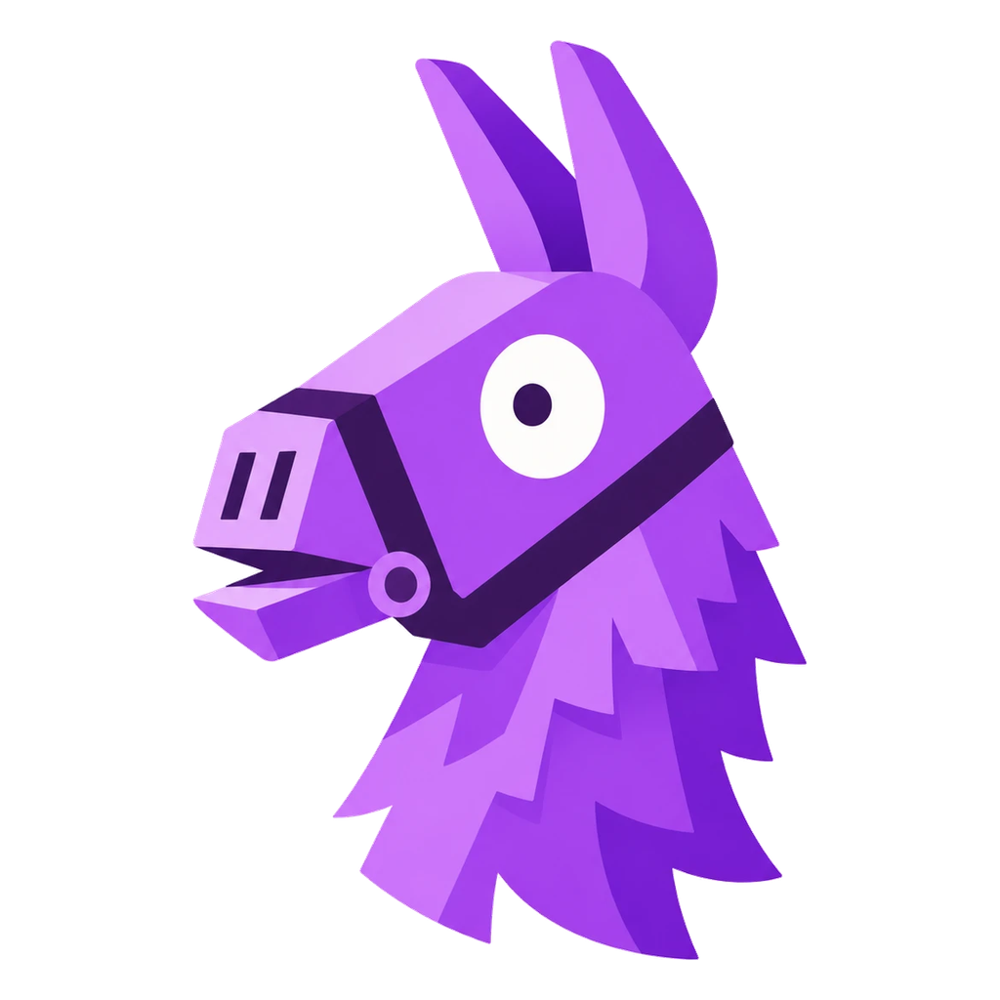

<div align="center">



# Laamacut

### Edit fast. Export smooth.

A free video editor for Android and Windows. No watermark, no account, no ads.<br>
Cut clips, add captions, text to speech, mix audio, and export up to 120fps.

**[⬇ Download for Android or Windows](https://github.com/archnemasis/laamacut/releases/latest)** &nbsp;·&nbsp; **[☕ Support Laamacut](https://ko-fi.com/laamacut)** &nbsp;·&nbsp; **[Report a problem](https://github.com/archnemasis/laamacut/issues)**

[](LICENSE)
[](https://github.com/archnemasis/laamacut/releases/latest)

</div>

---

## Make something worth watching

From a quick clip to a longer edit, Laamacut gives you a timeline, a live preview, and control over the details.

| What you want to do | What you can use |
| :--- | :--- |
| **Get to the good part** | Trim, split, crop, ripple delete, rearrange clips, and change playback speed. |
| **Build your story** | Stack video, audio, text, and graphics on multiple tracks. Add transitions and animate with keyframes. |
| **Make every word readable** | Create and style captions, import SRT subtitles, and add animated titles. |
| **Make it sound right** | Mix music and dialogue with waveforms, volume controls, fades, EQ, compression, and audio ducking. |
| **Find your look** | Adjust color with wheels, curves, HSL controls, and LUTs. Add effects, masks, and chroma key. |
| **Fit the platform** | Pick 16:9, 9:16, 1:1 and more right in the editor, with the apps each shape suits. |

## Start editing in seconds

1. **Hit Create project.** No setup screens.
2. **Import your media** and drag clips onto the timeline.
3. **Shape your edit** with cuts, captions, music, color, and transitions.
4. **Export.** Name your video and pick quality, frame rate, and bitrate on one simple page.

## Smooth exports, up to 120fps

| | |
| :--- | :--- |
| **Frame rate** | 24, 30, 60, or 120fps. |
| **Quality** | Simple bitrate presets (Lower, Recommended, Higher), or set your own. |
| **Codecs** | H.264 for everything, HEVC (H.265) for smaller files at the same quality. |
| **Resolution** | Up to 4K. |

On PC, exports use your graphics card's hardware encoder when it can, so they finish fast.

## Your footage stays yours

- **Everything happens on your device.** Nothing is uploaded to a server.
- **No watermark.** Your finished video is yours.
- **Auto-save.** Your projects save as you work and show up in Recent projects with a preview.
- **Free and open source,** under the MIT licence.

## Install

### Android

1. On your phone, open [Releases](https://github.com/archnemasis/laamacut/releases/latest) and download **`Laamacut-….apk`**.
2. Open it. If Android asks, let your browser install apps.
3. Tap **New video** and pick clips from your gallery.

Needs Android 6 or newer.

### Windows

1. Go to [Releases](https://github.com/archnemasis/laamacut/releases/latest) and download **`Laamacut-…-x64.exe`**.
2. Run it. Laamacut installs and opens straight away, and adds itself to the Start menu.
3. If Windows SmartScreen warns you, choose **More info → Run anyway**. The installer isn't code-signed yet.

Needs Windows 10 or 11 (64-bit). Larger projects and 4K footage run best with plenty of memory and a decent graphics card. Laamacut is in **alpha**, so expect a few rough edges.
---

## Build it yourself

Install [Node.js](https://nodejs.org/) and the pnpm version declared in [`package.json`](package.json), clone the repo, and run `pnpm install`.

<details>
<summary><strong>Building the Windows and Android apps</strong></summary>

<br>

**Windows installer** (output in `apps/desktop/release`):

```bash
cd apps/web && OPENREEL_DESKTOP=1 pnpm build
cd ../desktop && pnpm run build:main && pnpm exec electron-builder --win nsis --x64
```

**Android APK** needs JDK 21 and the Android SDK (platform 35). Put your signing key details in `apps/android/android/keystore.properties` (`storeFile`, `storePassword`, `keyAlias`, `keyPassword`), then:

```bash
cd apps/android && pnpm run apk
```

</details>

<details>
<summary><strong>Inside the project</strong></summary>

<br>

| Path | Purpose |
| :--- | :--- |
| [`apps/web`](apps/web) | The editor interface that runs inside the app |
| [`apps/desktop`](apps/desktop) | Windows app and installer |
| [`apps/android`](apps/android) | Android app |
| [`packages/core`](packages/core) | Timeline, media, audio, rendering, and export engines |
| [`packages/ui`](packages/ui) | Shared interface components |

Built with React, TypeScript, Electron, Capacitor, MediaBunny, WebCodecs, WebGPU, and Web Audio.

</details>

## Keep it free

Laamacut has no ads, no watermark and no paid tier. If it saved you time, you can [buy me a coffee on Ko-fi](https://ko-fi.com/laamacut). Starring the repo and sharing it helps too.

## Found a bug?

[Open an issue](https://github.com/archnemasis/laamacut/issues/new) with what you tried, what happened, and how to make it happen again.

---

<div align="center">

Laamacut is built on [OpenReel Video](https://github.com/Augani/openreel-video) by [Augustus Otu](https://github.com/Augani) and contributors.<br>
[MIT License](LICENSE)

</div>
